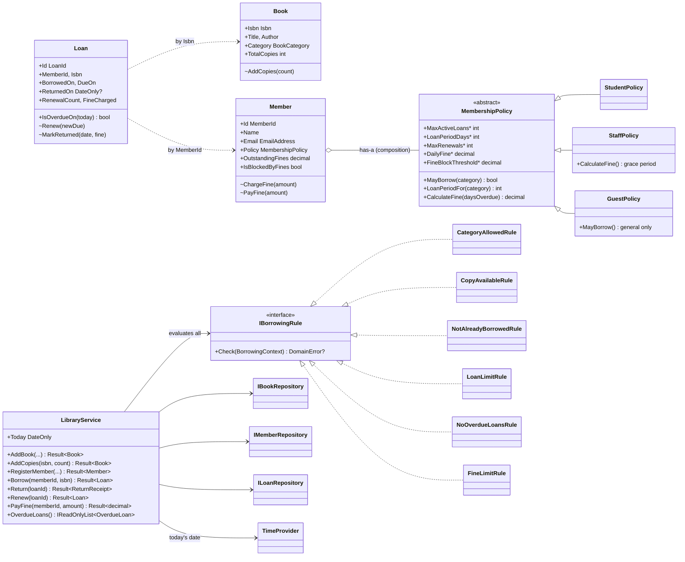

# Library Management Engine

Assignment 03 (Week 3): a console library management system in C# / .NET 10.

It handles **books, members, borrowing, returns, due dates, renewals and fines**, with
**different borrowing rules per membership type and per book category**, and validates
every input. All the business logic lives in a class library with no console code. A thin
console app sits on top of it.

| | |
|---|---|
| **Tests** | 308 automated tests (224 core + 84 console), all passing |
| **Coverage** | Core: 99.7 % lines, 96.2 % branches. Console app: 94.4 % lines, 90.2 % branches |
| **Build** | Warnings are errors; .NET analyzers (`Recommended`) and code style enforced at build time |
| **CI** | GitHub Actions builds and tests on every push / PR touching this folder |

---

## Contents

1. [Quick start](#1-quick-start)
2. [What it does](#2-what-it-does)
3. [Borrowing rules](#3-borrowing-rules)
4. [Class design](#4-class-design)
5. [Engineering decisions](#5-engineering-decisions)
6. [Validation strategy](#6-validation-strategy)
7. [Testing](#7-testing)
8. [Sample session](#8-sample-session)
9. [Assumptions](#9-assumptions)
10. [Known limitations and next steps](#10-known-limitations-and-next-steps)
11. [How the Assignment 02 feedback was applied](#11-how-the-assignment-02-feedback-was-applied)
12. [Project structure](#12-project-structure)

---

## 1. Quick start

**Prerequisite:** [.NET 10 SDK](https://dotnet.microsoft.com/download) (`dotnet --version` should print `10.x`).

```bash
cd library-management-engine

# Run the app. It starts with 7 sample books and 3 sample members (one of each type).
dotnet run --project src/LibraryManagement.ConsoleApp

# Start with an empty library instead
dotnet run --project src/LibraryManagement.ConsoleApp -- --empty

# Build and run all tests
dotnet test LibraryManagement.slnx
```

No environment variables, database or network access are needed.

**Tips for trying it out**

- Option **12** prints the borrowing rules for each membership type.
- Option **13** moves the date forward, so you can watch loans become overdue and fines
  build up without waiting two weeks.
- Type **`cancel`** at any prompt to go back to the menu. Nothing is changed when you do.
- IDs can be typed loosely: `M-0001`, `m-1` and `1` all mean member 1.
- ISBNs can be typed with or without hyphens, as ISBN-10 or ISBN-13.

---

## 2. What it does

### Requirements traceability

| Requirement | How it is met | Main code | Tests |
|---|---|---|---|
| **Books** | Add titles (ISBN, title, author, category, copies), add copies to an existing title, list, search by title / author / ISBN. Shows live availability. | `Book`, `Isbn`, `LibraryService` (catalogue) | `BookTests`, `IsbnTests`, `CatalogueAndMemberTests` |
| **Members** | Register with name, e-mail and membership type. Duplicate e-mails are refused. List members; account view with loan history, overdue count and fines. | `Member`, `EmailAddress`, `MemberId` | `MemberTests`, `EmailAddressTests`, `CatalogueAndMemberTests` |
| **Borrowing** | A loan is created only if every borrowing rule passes. A refusal lists **all** the reasons at once. | `LibraryService.Borrow`, `Rules/*` | `BorrowTests`, `BorrowingRuleTests` |
| **Returns** | Check-in works out how many days late the item is and charges the fine to the member in the same step. | `LibraryService.Return`, `ReturnReceipt` | `ReturnTests` |
| **Due dates** | Due date = borrow date + the membership's loan period, capped at 3 days for short-loan items. Renewals extend from the current due date. Overdue report. | `MembershipPolicy.LoanPeriodFor`, `Loan` | `LoanTests`, `MembershipPolicyTests`, `RenewFineAndReportTests` |
| **Different borrowing rules** | Three membership policies (Student / Staff / Guest) with different limits and behaviour, three book categories (General / ShortLoan / Reference), and six pluggable eligibility rules. | `Policies/*`, `Rules/*` | `MembershipPolicyTests`, `BorrowingRuleTests` |
| **Validation** | Three layers: input parsers that ask again, value objects that can't hold invalid data, and entity guard clauses. See [section 6](#6-validation-strategy). | `Input/*`, `Domain/*`, `Common/Guard` | `ParsersTests`, `PrompterTests`, `LibraryAppTests` |
| **OOP, not one class** | 40+ focused types across two projects, using encapsulation, abstraction, inheritance, polymorphism, composition and interfaces. | See [section 4](#4-class-design) | |

**Beyond the brief:** renewals, fine payment, an overdue report, a simulated clock for
demos, sample data, and CI.

---

## 3. Borrowing rules

The rules screen (menu option 12) builds this table from the policy objects themselves, so
the help text can't drift from the rules the code enforces.

| Membership | Max items | Loan period | Renewals | Fine per day | Borrowing blocked if owing more than | Special behaviour |
|---|---|---|---|---|---|---|
| **Student** | 3 | 14 days | 1 | KES 10 | KES 100 | none |
| **Staff** | 10 | 28 days | 3 | KES 5 | KES 500 | First 3 overdue days are free (grace period) |
| **Guest** | 1 | 7 days | 0 | KES 20 | KES 0 (any fine blocks) | General collection only |

**Rules for everyone**

| Rule | Enforced by |
|---|---|
| Reference books are never lent | `CategoryAllowedRule` (through `MembershipPolicy.MayBorrow`) |
| Short-loan items are due within 3 days and cannot be renewed | `MembershipPolicy.LoanPeriodFor`, `LibraryService.Renew` |
| A copy must be on the shelf | `CopyAvailableRule` |
| Only one copy of a title per member at a time | `NotAlreadyBorrowedRule` |
| No more items than the membership allows | `LoanLimitRule` |
| Overdue items must be returned before borrowing more, and cannot be renewed | `NoOverdueLoansRule`, `LibraryService.Renew` |
| Unpaid fines above the threshold block both borrowing and renewing | `FineLimitRule`, `LibraryService.Renew` |
| One loan's fine is capped at KES 300 (roughly a replacement cost) | `MembershipPolicy.CalculateFine` |

---

## 4. Class design

### Layers

```
┌──────────────────────────────────────────────────────────────────────┐
│ LibraryManagement.ConsoleApp  (presentation: text in, text out)      │
│   Program ─► LibraryApp (menu loop) ─► Screens ─► Prompter / Parsers │
│                                              └─► Table / Display     │
│   AdjustableClock : TimeProvider        SampleData                   │
└───────────────────────────────┬──────────────────────────────────────┘
                                │ calls only LibraryService
┌───────────────────────────────▼──────────────────────────────────────┐
│ LibraryManagement.Core  (no Console calls anywhere)                  │
│   Services     LibraryService (one entry point per use case)         │
│   Rules        IBorrowingRule ×6, BorrowingContext, BorrowingRules   │
│   Policies     MembershipPolicy ◄─ Student / Staff / GuestPolicy     │
│   Domain       Book, Member, Loan + value objects (Isbn, ...)        │
│   Persistence  I*Repository  ◄─ InMemory*Repository                  │
│   Common       Result<T>, DomainError, ErrorCodes, Guard, Money      │
└──────────────────────────────────────────────────────────────────────┘
```

Dependencies point one way only: the console app knows about the core, and the core knows
nothing about consoles. A web API or GUI could use `LibraryService` unchanged.

### Class diagram (core)



(`~` = internal: only the service can call it. `*` = abstract.)

### Responsibilities

| Type | Kind | Responsibility |
|---|---|---|
| `Isbn`, `EmailAddress` | `sealed record` value objects | Validate on creation and normalise (ISBN-10 becomes ISBN-13; e-mail is lower-cased). Compared by value. |
| `MemberId`, `LoanId` | `readonly record struct` | Strongly-typed ids: the compiler stops a loan id being passed where a member id is expected. |
| `Book` | entity | One catalogue title and its copy count. Guards its own invariants. |
| `Member` | entity | Identity, membership policy and fine balance. Its fine balance can only be changed by the service. |
| `Loan` | entity | One copy lent to one member, from borrowing through renewal to return. |
| `MembershipPolicy` and its 3 subclasses | abstract class + inheritance | The terms of a membership. Numbers are abstract properties; behaviour that really differs is a virtual method that subclasses override. |
| `IBorrowingRule` and 6 rules | interface + implementations | Each rule is one small, pure eligibility check. |
| `BorrowingContext` | `sealed record` | Everything a rule needs, gathered once, so rules don't need repositories or a clock. |
| `LibraryService` | application service | One method per use case. Coordinates repositories, rules and policies so each operation is a single consistent step. |
| `I*Repository` / `InMemory*Repository` | interfaces + implementations | Storage, kept separate from the business logic. |
| `Result<T>`, `DomainError` | result types | Carry expected refusals as values, each with a stable `Code` and a readable `Message`. |
| `LibraryApp` | console | The menu loop: repeats until Exit, handles cancel and closed input. |
| `Screen` and 4 screen classes | abstract base + subclasses | Turn text into service calls and service results back into text. They make no business decisions. |
| `Prompter`, `Parsers`, `ParseOutcome<T>` | console | Ask again until the input is valid. The parsers are pure functions. |
| `AdjustableClock` | `TimeProvider` subclass | The real time plus an offset that only moves forward (for demos). |

### Where each OOP concept is used

| Concept | Where, and why it's useful here |
|---|---|
| **Encapsulation** | `private set` on all state. State-changing methods (`Member.ChargeFine`, `Loan.MarkReturned`, `Book.AddCopies`) are `internal`, so the UI can read a balance but only `LibraryService` can change it, and only as part of a return or a payment. |
| **Abstraction** | `LibraryService` hides repositories, rules and policies behind methods named after what a librarian does. `IBorrowingRule` and the repositories are abstractions the service depends on. |
| **Inheritance** | `MembershipPolicy` → `StudentPolicy` / `StaffPolicy` / `GuestPolicy`. `Screen` → four screen groups that share I/O helpers. `AdjustableClock : TimeProvider`. |
| **Polymorphism** | `member.Policy.CalculateFine(days)` gives a grace period for staff and a plain daily rate for others, and the service never checks which type it has. `MayBorrow` is overridden for guests. Six rules run through one `Check` call. |
| **Composition** | A `Member` *has a* `MembershipPolicy` rather than *being* a `StudentMember` (see decision D1). `LibraryService` is built from repositories, a clock and a rule list. |
| **Interfaces** | `IBorrowingRule`, `IBookRepository`, `IMemberRepository`, `ILoanRepository`. |
| **Records** | Value objects (`Isbn`, `EmailAddress`), ids (`MemberId`, `LoanId`), and immutable data carriers (`BorrowingContext`, `ReturnReceipt`, `OverdueLoan`, `DomainError`), following the course's *records* resource. Entities with a lifecycle (`Book`, `Member`, `Loan`) are deliberately classes, not records, because two loans with equal fields are still different loans. |

---

## 5. Engineering decisions

Each decision lists the options I considered and the trade-off I accepted.

### D1. Membership rules are policy objects held by a member, not subclasses of `Member`

- **Options considered:** (a) `StudentMember : Member`, `StaffMember : Member`; (b) a
  `MembershipType` enum with `switch` statements in the service; (c) a `MembershipPolicy`
  class hierarchy that each `Member` holds.
- **Chosen:** (c).
- **Why:** who a member is (id, name, e-mail, fines) doesn't change when the rules that apply
  to them change. With (a), a student who joins the staff would need to become a different
  object. With (b), every new membership type means editing switch statements spread
  through the code. With (c), a new type such as "Alumni" is one new class plus one line in
  `MembershipPolicy.For`; `Member`, `LibraryService` and the rules stay untouched.
- **Trade-off:** one more level of indirection (`member.Policy.MaxActiveLoans` instead of
  `member.MaxActiveLoans`).

### D2. Limits are abstract properties; only real behaviour differences are virtual methods

- **Why:** most of what differs between memberships is just a number, so subclasses override
  numbers. Behaviour is overridden only where it actually differs: `StaffPolicy.CalculateFine`
  (grace period) and `GuestPolicy.MayBorrow` (general collection only). That keeps
  polymorphism where it earns its place instead of forcing it everywhere.

### D3. Borrowing eligibility is a list of small `IBorrowingRule` classes, and all of them run

- **Options considered:** one long `if` chain in `Borrow()`; stop at the first failure; run
  every rule.
- **Chosen:** six single-purpose rule classes behind one interface, injected into the
  service. Every rule is evaluated.
- **Why:** each rule is a pure function of a `BorrowingContext`, so it can be tested without
  a library. A new rule (for example "no lending during stock-take") is a new class and
  needs no edit to `LibraryService`. A test injects exactly such a rule to prove it. Running
  every rule means a refused member hears every reason at once ("limit reached *and* fines
  too high") instead of fixing one problem and being refused again for the next.
- **Trade-off:** six classes instead of one method, and the order of messages depends on the
  order of the list.

### D4. Expected refusals are `Result` values; exceptions are for bugs

- **Why:** "loan limit reached" is a normal outcome at a library desk, not an exceptional
  one. Returning `Result<T>` makes the possibility of refusal visible in every method
  signature and forces the caller to deal with it. Exceptions are kept for broken
  invariants, such as constructing a `Book` with a blank title. That can only happen if a
  caller skipped validation, which is a bug.
- **Every error has a stable `Code`** (`borrow.loan_limit_reached`), and tests assert on codes,
  never on wording. Messages can be reworded without breaking a single test.

### D5. Book availability is derived from loans, not stored as a counter

- **Options considered:** an `AvailableCopies` field on `Book` that goes down on borrow and up
  on return; or computing `TotalCopies - active loans` when it's needed.
- **Chosen:** derived.
- **Why:** a single source of truth. A stored counter is a second copy of information the
  loan records already hold, and the two can drift out of sync (a missed increment, a
  failed operation halfway through). Derived availability can't be wrong.
- **Trade-off:** each availability check scans the active loans, which is negligible at
  library scale. A database would index by ISBN.

### D6. Time is injected as `TimeProvider`, never read from `DateTime.Now`

- **Why:** due dates and fines depend on "today". With the built-in .NET `TimeProvider`
  abstraction, tests use Microsoft's `FakeTimeProvider` to pin the date and move it forward
  ("advance 15 days, then return") with no flaky or slow tests. The same seam powers the
  console's *Advance the date* option through `AdjustableClock`, and the core can't tell the
  difference.

### D7. Value objects and strongly-typed ids

- `Isbn` checks the check digit and the 978/979 book prefix. It also converts ISBN-10 to
  ISBN-13, so the same book typed both ways is recognised as **one** catalogue entry instead
  of two entries with split copy counts.
- `EmailAddress` is lower-cased, so `Amina@X.org` and `amina@x.org` can't register twice.
  Validation is deliberately pragmatic, not full RFC 5322: the only real proof an address
  works is sending mail to it.
- `MemberId` / `LoanId` are separate types, so `Borrow(loanId, ...)` doesn't compile.

### D8. Entities reference each other by id, and only the service can change state

- `Loan` stores `MemberId` and `Isbn`, not `Member` and `Book` objects. That keeps the object
  graph flat and maps one-to-one onto database tables if persistence is added.
- State-changing methods are `internal`, so a fine can only be charged as part of a return.
  Taken together, the service is the one place where every multi-object change (loan,
  member balance, availability) happens in one step.

### D9. Repository interfaces even though there is one implementation

- **Why:** persistence (a JSON file or SQLite) is the most likely next requirement, and the
  interfaces mean it can be added without touching borrowing logic.
- **Honest trade-off:** today this is a seam with a single implementation. The interfaces
  are small (3–7 methods), so the cost is low, but I'd accept the criticism that it is
  slightly ahead of need.

### D10. Renewal extends from the due date, not from today

- **Why:** a student who renews early, three days before the due date, shouldn't lose those
  three days. Extending from the current due date is fair and predictable. Abuse is still
  limited by the renewal allowance, and renewal is refused for overdue items, for
  short-loan items and for members blocked by fines.

### D11. Overpaying a fine is refused, not stored as credit

- **Why:** a credit balance would need a refund process, which doesn't exist. Refusing the
  payment at the counter is simpler and never leaves the library holding money it doesn't
  need.

### D12. The UI re-asks for each field; `cancel` is always available

- **Why:** this applies Assignment 02 feedback point 2. A blank name, a bad ISBN or a taken
  e-mail asks again for *that field only*. To make sure a re-prompt loop can never trap the
  user, typing `cancel` at any prompt goes back to the menu without changing anything. Closed
  input (Ctrl+Z / Ctrl+D, or the end of a piped script) exits cleanly instead of looping
  forever.

### D13. Strict build settings live in one place

- `Directory.Build.props` holds the target framework, nullable reference types, implicit
  usings, warnings-as-errors and the `Recommended` analyzer set. The `.csproj` files contain
  **only** project-specific settings (output type, references, packages). This applies
  Assignment 02 feedback point 4. `.editorconfig` enforces file-scoped namespaces, braces
  and naming conventions at build time.

---

## 6. Validation strategy

Validation happens in three layers, each with a different job.

| Layer | Where | On bad input | Purpose |
|---|---|---|---|
| **1. Input** | `Parsers`, `Prompter`, `Screen` helpers | Explains the problem and **asks again** | A good experience for the user: blank or too-long text, numbers out of range, a bad ISBN check digit, a malformed or already-registered e-mail, an unknown member / book / loan id, overpayment |
| **2. Value objects** | `Isbn`, `EmailAddress`, `MemberId`, `LoanId` | `TryParse` returns false; `Parse` throws | An invalid ISBN or e-mail can't exist anywhere in the program |
| **3. Entity guards** | `Book`, `Member`, `Loan` constructors and methods (`Guard`) | Throws `ArgumentException` | Invalid state is impossible even if a future caller (an API, say) skips layer 1 |

Business-rule refusals (loan limit, fines, no copies, and so on) aren't validation
failures. They come back from `LibraryService` as `Result` failures with one or more
`DomainError`s (decision D4).

---

## 7. Testing

```bash
dotnet test LibraryManagement.slnx
# Passed!  - Failed: 0, Passed: 224 - LibraryManagement.Core.Tests.dll
# Passed!  - Failed: 0, Passed:  84 - LibraryManagement.ConsoleApp.Tests.dll

# with coverage (coverlet; writes Cobertura XML under tests/*/TestResults)
dotnet test LibraryManagement.slnx --collect:"XPlat Code Coverage"
```

| Test project | What it covers |
|---|---|
| `Core.Tests/Domain` | Value-object parsing (valid, invalid, normalisation, ISBN-10 ↔ 13 equality), entity invariants, loan lifecycle |
| `Core.Tests/Policies` | Every policy limit, loan period per category, fine maths including the staff grace period and the per-loan cap |
| `Core.Tests/Rules` | Each rule passing and failing in isolation; `Evaluate` reporting several violations |
| `Core.Tests/Services` | Every use case through `LibraryService` with a `FakeTimeProvider`, e.g. "borrow, advance 25 days, return, check the fine, pay, borrow again". Includes injecting a custom rule. |
| `Core.Tests/Persistence` | In-memory repositories: id issuing, indexes, active vs history |
| `ConsoleApp.Tests/Input` | Every parser message; the prompter asking again (e.g. a blank name asked twice), `cancel`, closed input |
| `ConsoleApp.Tests/LibraryAppTests` | **End-to-end:** scripted keystrokes in, the full transcript checked, against a frozen clock. Covers the complete borrow → overdue → return → pay → unblocked lifecycle, every refusal path, cancel, closed input, and every empty-library message. |

**Conventions:** tests are named `Method_Scenario_Expectation`, built with Arrange–Act–Assert
and the `TestData` builders, assert on error *codes* rather than wording, and every test
gets a fresh library (no shared state).

**What isn't covered, and why:** `Program.cs` (the composition root, which only runs as a
real process; I checked it manually with a piped session), and a few defensive "refused"
branches in the screens that the UI can't reach, because it validates input before calling
the service.

---

## 8. Sample session

A real run with sample data loaded. Typed input is shown after each prompt. The menu is
printed before every choice and is shown in full only once here.

```text
Loaded sample data: 7 books and 3 members (start with --empty to skip).
Library Management Engine

=== Main menu | today: 2026-11-22 ===
 Catalogue
    1) Add a book or copies
    2) List all books
    3) Search books
 Members
    4) Register a member
    5) List members
    6) Member account (loans and fines)
 Circulation
    7) Borrow a book
    8) Return a book
    9) Renew a loan
   10) Pay a fine
   11) Overdue report
 Other
   12) Borrowing rules by membership
   13) Advance the date (simulate time passing)
    0) Exit
Choose an option: 4

--- Register a member ---
  (Type 'cancel' at any prompt to return to the menu.)
Full name:
  ! This cannot be blank.
Full name: Wanjiku Kamau
E-mail: amina.otieno@example.org
  ! amina.otieno@example.org is already registered to Amina Otieno (M-0001).
E-mail: wanjiku@example.org
  Membership type:
  1) Student   2) Staff   3) Guest
Membership: 1
  Done: registered Wanjiku Kamau as M-0004 (Student).
  Allowance: up to 3 item(s) for 14 days, 1 renewal(s), KES 10.00 per overdue day.

Choose an option: 7

--- Borrow a book ---
  (Type 'cancel' at any prompt to return to the menu.)
Member id (e.g. M-0001): M-0001
Book ISBN: 9780132350884
  Done: lent 'Clean Code' to Amina Otieno. Loan L-0001 is due back on 2026-12-06 (14 days).

Choose an option: 7

--- Borrow a book ---
  (Type 'cancel' at any prompt to return to the menu.)
Member id (e.g. M-0001): M-0003
Book ISBN: 9780134685991
  Not possible: 'Effective Java (3rd ed.)' cannot be lent to Grace Wanjiru:
   - Guest members cannot borrow ShortLoan items such as 'Effective Java (3rd ed.)'.

Choose an option: 13

--- Advance the date (simulation) ---
  (Type 'cancel' at any prompt to return to the menu.)
  Today is 2026-11-22. Moving time forward lets you see due dates, overdue items and fines.
Days to move forward (1-365): 20
  Done: today is now 2026-12-12 (20 days ahead of the real date).
  1 loan(s) are now overdue. See 'Overdue report'.

Choose an option: 11

--- Overdue report ---
  Loan    Member                  Title       Due         Days late  Fine if returned today
  ------  ----------------------  ----------  ----------  ---------  ----------------------
  L-0001  Amina Otieno (Student)  Clean Code  2026-12-06  6 days     KES 60.00

Choose an option: 8

--- Return a book ---
  (Type 'cancel' at any prompt to return to the menu.)
  Loan    Member        Title       Borrowed    Due         Status
  ------  ------------  ----------  ----------  ----------  --------------
  L-0001  Amina Otieno  Clean Code  2026-11-22  2026-12-06  OVERDUE 6 days
Loan id (e.g. L-0001): L-0001
  Done: 'Clean Code' returned by Amina Otieno, 6 days late.
  Fine charged: KES 60.00.
  Amina Otieno now owes KES 60.00.

Choose an option: 10

--- Pay a fine ---
  (Type 'cancel' at any prompt to return to the menu.)
  Id      Name          Owes
  ------  ------------  ---------
  M-0001  Amina Otieno  KES 60.00
Member id: M-0001
Amount to pay (owes KES 60.00): 500
  ! That is more than the KES 60.00 owed.
Amount to pay (owes KES 60.00): 60
  Done: received KES 60.00 from Amina Otieno. Remaining balance: KES 0.00.

Choose an option: 0
Goodbye.
```

---

## 9. Assumptions

- **One branch, one operator.** The app is used at the desk by a librarian, so there are no
  logins or member self-service.
- **A "book" is a title with interchangeable copies.** Copies aren't tracked individually,
  so the system knows *how many* copies of a title are out, not *which* physical copy.
- **Due dates are whole calendar days** in the machine's local time zone. An item returned
  on its due date is on time, and the first overdue day is the day after.
- **Fines are only for lateness**, in Kenyan shillings (KES), and capped per loan. Lost or
  damaged items aren't charged separately.
- **The rule values** (limits, periods, fines) are my own reasonable choices, because the
  brief doesn't specify any. They live in one place per membership and are easy to change.
- **"Different borrowing rules"** is read as covering both *who* borrows (membership type)
  and *what* is borrowed (book category). Both are implemented.

---

## 10. Known limitations and next steps

I'm stating these plainly rather than leaving them for the marker to find.

| Limitation | Impact | What I would do next |
|---|---|---|
| **In-memory storage only** | All data is lost when the program exits (sample data reloads on start). | Add `JsonFile*Repository` or SQLite implementations of the existing repository interfaces. No business logic would change (D9). |
| **No editing or removal** of books or members | A typo in a title stays until restart; a member can't be deactivated. | `UpdateBook`, `WithdrawCopies` (refused while copies are on loan), member deactivation that keeps loan history. |
| **No reservations / holds** | A member can't queue for a title that is fully on loan. | A `Reservation` entity, plus a rule that refuses renewal when someone is waiting. |
| **Copies aren't individually tracked** | A specific damaged copy can't be identified. | Introduce a `Copy` entity with its own barcode; loans would reference copies. |
| **Not thread-safe** | Fine for a single console user; unsafe if shared by a multi-user server. | Use a database's transactions, or a lock around each `LibraryService` operation. |
| **The word `cancel`** can't be entered as a value | A book literally titled "Cancel" can't be added through the console. | Use a key such as Esc for cancelling in an interactive terminal. |
| **English-only messages** | Not localised. | Error codes are already separate from messages (D4), so messages could move into resource files keyed by code. |
| **Simulated date only moves forward** | It's a demo aid, not a library feature. | In a real deployment it would be removed or kept behind a debug flag. |

---

## 11. How the Assignment 02 feedback was applied

| Feedback | What changed in this assignment |
|---|---|
| 1. *Say plainly when a requirement is not met exactly.* | Requirements are traced in [section 2](#2-what-it-does), the ways I interpreted the brief are listed in [section 9](#9-assumptions), and limitations in [section 10](#10-known-limitations-and-next-steps), including one design choice I'd defend but accept criticism on (D9). |
| 2. *Re-prompt on a blank name instead of returning to the menu.* | Every prompt asks again for that field only (`Prompter.Read`), with `cancel` as a way out. Tested in `PrompterTests.ReadText_BlankAnswer_AsksAgainInsteadOfGivingUp` and `LibraryAppTests.RegisterMember_BlankName_IsAskedAgainNotAbandoned`. |
| 3. *Keep state private (`GuessingGame.Target` was public).* | All state is `private set`, and state changes are `internal` to the core, so only `LibraryService` can change balances or loans (D8). |
| 4. *Remove duplicate settings from the `.csproj` files.* | `Directory.Build.props` is the only place they are set. Each `.csproj` holds only project-specific items (D13). |
| 5. *Explain more design decisions and why.* | [Section 5](#5-engineering-decisions) records 13 decisions, each with the alternatives considered and the trade-off accepted. |

---

## 12. Project structure

```
library-management-engine/
├── Directory.Build.props          shared build settings (the only copy)
├── .editorconfig                  style rules enforced at build time
├── LibraryManagement.slnx
├── src/
│   ├── LibraryManagement.Core/            business logic, no Console calls
│   │   ├── Common/        Result<T>, DomainError, ErrorCodes, Guard, Money
│   │   ├── Domain/        Book, Member, Loan, Isbn, EmailAddress, MemberId, LoanId, enums
│   │   ├── Policies/      MembershipPolicy + Student/Staff/Guest policies
│   │   ├── Rules/         IBorrowingRule, BorrowingContext, BorrowingRules + 6 rules
│   │   ├── Persistence/   repository interfaces + InMemory implementations
│   │   └── Services/      LibraryService, BookAvailability, ReturnReceipt, OverdueLoan
│   └── LibraryManagement.ConsoleApp/      console front end (assembly: library)
│       ├── Program.cs     composition root
│       ├── LibraryApp.cs  menu loop
│       ├── SampleData.cs
│       ├── Input/         Prompter, Parsers, ParseOutcome, input exceptions
│       ├── Output/        Table, Display
│       ├── Screens/       Screen base + Catalogue/Member/Circulation/Admin screens
│       └── Time/          AdjustableClock
└── tests/
    ├── LibraryManagement.Core.Tests/        224 tests
    └── LibraryManagement.ConsoleApp.Tests/   84 tests (including end-to-end sessions)
```

### Development workflow

The work was done on the `assignment03-library-management-engine` branch in small commits
that build on each other: scaffold → value objects → policies → entities → rules →
repositories → service use cases → console building blocks → screens → tests → CI → docs.
Each commit builds and passes its tests, and the commit messages explain *why*, not only
*what*. The GitHub Actions workflow (`.github/workflows/library-management-engine.yml`)
re-runs the build and tests on every push and pull request.
